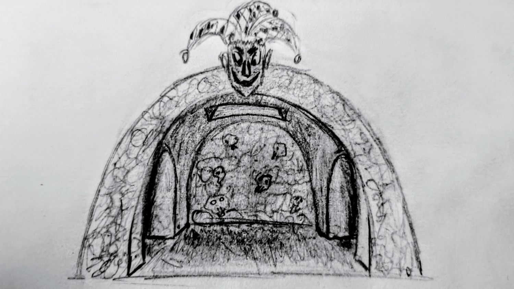

Jester's Maze aims to become a great network-based game for the C64U/U64 platform.
Currently, it only has an explorer function, meaning you can only explore the maze to find the exit.
Later on, obstacles and puzzles will also be added.
Graphics and sound will be added later as well.
Exploration is done with a joystick in Port 2.
The server that contains the maze is written in Go and is located in the src/server directory.
It is compiled with:

go build -trimpath -ldflags "-w -s"

After starting, the server listens on port 64646.

Function Keys used in the game:
- F1 - reset to start
- F7 - exit game (disconnect from server)

TODO's
- Graphic screens (Currently I have only basic ideas)
- Sound
- Several Mazes

![PotentialTitleScreen][]
![CaveHandDrawing][]

